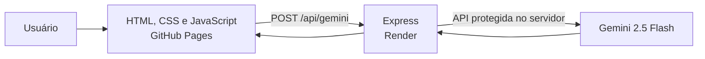

# Veridictum — tradutor NL ↔ CPC

Aplicação web para traduzir sentenças em português para fórmulas do Cálculo Proposicional Clássico (CPC) e fazer a conversão inversa com o Gemini.

- Frontend: [thursilveira.github.io/veridictum](https://thursilveira.github.io/veridictum/)
- API: [veridictum.onrender.com](https://veridictum.onrender.com/)
- Demonstração: [YouTube](https://youtu.be/bG_rJpK4Vvo)

## Arquitetura



O frontend monta instruções específicas para cada modo e envia o prompt ao backend. O backend valida e limita as requisições antes de encaminhá-las ao Gemini. A chave da API existe apenas no ambiente do Render.

## Funcionalidades

- Linguagem natural → CPC, com dicionário de proposições.
- CPC → linguagem natural.
- Operadores `∧`, `∨`, `¬`, `→` e `↔`, além de `^`, `v`, `~`, `->` e `<->`.
- Interface responsiva e atalhos para inserir operadores.
- Proteção contra injeção de HTML, política CSP e timeout no navegador.
- CORS restrito, rate limit, limite de tamanho, headers de segurança e respostas de erro sanitizadas na API.
- Health check em `GET /health`.

## Execução local

Requisitos: Node.js 20–26; Node.js 24 é a versão recomendada e usada no CI/deploy.

```bash
cd backend
cp .env.example .env
npm ci
npm start
```

Preencha `GEMINI_API_KEY` no `.env`. O arquivo é ignorado pelo Git e não deve ser versionado. Sirva o frontend a partir da raiz do repositório, por exemplo na porta `5500`, e acesse a URL fornecida pelo servidor estático.

Variáveis do backend:

| Variável | Obrigatória | Padrão |
|---|---:|---|
| `GEMINI_API_KEY` | Sim | — |
| `PORT` | Não | `3000` |
| `CORS_ORIGINS` | Não | GitHub Pages e desenvolvimento local; aceita uma lista separada por vírgulas |

## Verificações

```bash
cd backend
npm run check
npm audit --omit=dev
```

A suíte cobre health check, headers, CORS, validação de prompts e respostas 404. O workflow de CI executa as verificações e a auditoria em pushes e pull requests. O Dependabot verifica semanalmente dependências npm e GitHub Actions.

## Deploy

- O GitHub Pages publica o frontend a partir da branch `main`.
- O `render.yaml` documenta o serviço do backend, o health check e as variáveis esperadas.
- O Render deve manter `GEMINI_API_KEY` como segredo e iniciar o serviço dentro de `backend` com `npm start`.

Em planos que suspendem serviços inativos, a primeira tradução após uma pausa pode levar mais tempo.

## Limitações

- A tradução usa um modelo de linguagem e pode conter imprecisões.
- Frases ambíguas ou condicionais muito longas exigem revisão humana.
- O escopo atual é lógica proposicional, não lógica de predicados.

## Equipe

- Arthur Silveira
- Guilherme Araki Alves
- Jeffer Henrique Pavan Cantarelo

Projeto desenvolvido na disciplina Lógica para Computação da Uni-FACEF.
